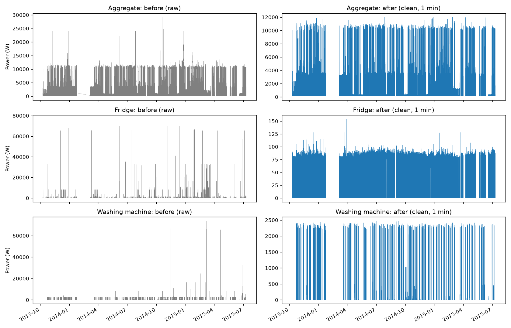

# DATA.md: Part 1, House 1 raw data checks and cleaning

This file covers Part 1 of the assignment. It describes which raw data was used, what problems were found, how the data was cleaned (and why), and what concerns are left.

All code is in `sourcecode/Section1.py`. Running it creates the cleaned file and the plot described below.

---

## 1. Data used

| Item | Value |
|---|---|
| Dataset | REFIT Electrical Load Measurements, **raw** version (`REFIT_RAW_081116.7z`), University of Strathclyde [1, 2] |
| House | **House 1** (Loughborough, UK; detached, 4 bed, 2 occupants, built 1975–1980) |
| Files | House 1 `Part1` and `Part2`, saved as `data/RAW_House1_Part1.csv` and `data/RAW_House1_Part2.csv` |
| Columns | `Time`, `Unix`, `Aggregate`, `Appliance1` … `Appliance9` (the readme calls the first two `DATETIME` and `UNIX TIMESTAMP`) |
| Units | Active power in **Watts (W)** |
| Sampling | Officially every **8 s** [1, 2]; the collection script polled every 6–8 s (readme). Median gap in House 1: **7 s** |
| Time column used | **`Unix`** (the readme says it is UTC). The `Time` text column is not used. |
| Date coverage | **2013-10-09 14:06:17 → 2015-07-10 11:56:32 UTC** (about 639 days, ~21 months) |

**House 1 appliances (from the readme)**

| Column | Appliance |
|---|---|
| Aggregate | Whole house (current clamp) |
| Appliance1 | Fridge |
| Appliance2 | Freezer (1) |
| Appliance3 | Freezer (2) |
| Appliance4 | Washer Dryer |
| Appliance5 | Washing Machine |
| Appliance6 | Dishwasher |
| Appliance7 | Computer |
| Appliance8 | Television Site |
| Appliance9 | Electric Heater |

**The two raw files**

| File | Rows | Start (UTC) | End (UTC) | Missing sensor shown as |
|---|---|---|---|---|
| Part1 | 4,377,877 | 2013-10-09 14:06:17 | 2014-10-01 01:27:07 | `0` |
| Part2 | 4,140,886 | 2014-06-27 21:57:49 | 2015-07-10 11:56:32 | `NaN` |

**Useful facts from the documentation**
- The raw data is untouched apart from a UK daylight saving time correction (readme).
- Each timestamp is the time the REFIT server **received** the reading [2], stored in whole seconds.
- The sensors are not synchronised, so an appliance reading can be a few seconds older than the aggregate reading on the same row [2, readme].
- In the raw data, `NaN` can mean **"the reading did not change"** or **"the sensor did not respond"**. Across the whole dataset, 6.4% of readings are NaN [2].

---

## 2. Joining Part1 and Part2

The two files **overlap for about 95 days** (27 Jun 2014 21:57:49 → 1 Oct 2014 01:27:07 UTC).

| In the overlap window | Count |
|---|---|
| Part1 rows | 1,257,865 |
| Part2 rows | 945,403 |
| Seconds found in both files | 290,008 |

- Only 290,008 seconds appear in both files, so the two files look like **two separate recordings** of the same sensors.
- A spot check of matching seconds showed Aggregate values only a few W apart (e.g. 324 vs 319 W).

**Steps taken**
1. **Part1 "fake zeros" → NaN.** In Part1 a missing sensor was saved as `0`.
   - A row where **all 10 columns are 0** → all set to NaN.
   - An **Aggregate of 0** → set to NaN (a house always uses some power).
   - A single appliance at 0 is kept as "off", because it can't be told apart from a real "off" (see Remaining concerns).
2. **Join rule:** use Part1 **until Part2 starts**, then Part2 only. Part2 is preferred because it marks missing values as NaN, so there is no 0-or-missing guessing.
3. **Result:** 3,120,012 rows from Part1 + 4,140,886 rows from Part2 = **7,260,898 rows**.

---

## 3. Quality checks (before cleaning)

### 3.1 Timestamps
- All `Unix` values parsed correctly (**0 bad timestamps**).
- **1 row** was out of order. Sorting by `Unix` fixes it.

### 3.2 Duplicate timestamps
| | Rows | % of 7,260,898 |
|---|---|---|
| Rows that repeat a second already seen | 597,182 | 8.2% |
| … exact copies (same second, same values in all 10 columns) | 508,829 | 7.0% |
| … same second but different values | 88,353 | 1.2% |

The REFIT papers do not explain the duplicates. REFIT's own cleaned release only says that timestamp duplicates were merged [3]. The rule used here is in Section 4.

### 3.3 Missing readings (NaN)
Counted after removing duplicates (6,663,716 rows), before any other cleaning.

| Column | Missing | % |
|---|---|---|
| Aggregate | 178,357 | 2.68 |
| Appliance1 Fridge | 432,895 | 6.50 |
| Appliance2 Freezer (1) | 453,551 | 6.81 |
| Appliance3 Freezer (2) | 305,917 | 4.59 |
| Appliance4 Washer Dryer | 504,183 | 7.57 |
| Appliance5 Washing Machine | 490,205 | 7.36 |
| Appliance6 Dishwasher | 335,025 | 5.03 |
| Appliance7 Computer | 225,296 | 3.38 |
| Appliance8 Television Site | 382,744 | 5.74 |
| Appliance9 Electric Heater | 1,901,655 | **28.54** |

- Appliances 1–8 are missing 3–8% of readings, close to the 6.4% reported for the whole dataset [2].
- **The Electric Heater is missing 28.5%**, far more than the others.
- **No row has all columns missing.** When the system was down, nothing was saved at all, so outages show up as **gaps in time**, not as NaN rows.

### 3.4 Irregular intervals (gaps between readings)
Counted after removing duplicates. **Median gap: 7 s**, which matches the 6–8 s polling.

| Gap between rows | Count |
|---|---|
| ≤ 8 s | 5,151,633 |
| 8 s – 1 min | 1,507,936 |
| 1 – 2 min | 3,605 |
| 2 – 10 min | 192 |
| 10 min – 1 h | 324 |
| > 1 h | 25 |
| **Total** | **6,663,715** (= rows − 1) |

- **541 gaps are longer than 2 minutes.**
- The 5 biggest gaps:

| From (UTC) | To (UTC) | Length |
|---|---|---|
| 2014-01-24 01:56 | 2014-03-06 16:23 | 998.4 h (~42 days) |
| 2015-05-10 23:36 | 2015-05-19 15:10 | 207.6 h |
| 2015-06-10 13:19 | 2015-06-18 01:39 | 180.3 h |
| 2014-08-28 04:23 | 2014-09-01 16:55 | 108.5 h |
| 2015-04-03 01:43 | 2015-04-07 10:18 | 104.6 h |

- The biggest gap (Jan–Mar 2014) matches the readme, which says data is missing "notably February 2014".
- These 5 gaps alone add up to about 1,600 h (~67 days).

### 3.5 Impossible or extreme values
Counted after removing duplicates.

| Column | Min (W) | Max (W) | Readings > 4000 W |
|---|---|---|---|
| Aggregate | 15 | 29,159 | – |
| Appliance1 Fridge | 0 | 76,677 | 761 |
| Appliance2 Freezer (1) | 0 | 98,301 | 35 |
| Appliance3 Freezer (2) | 0 | 73,725 | 115 |
| Appliance4 Washer Dryer | 0 | 98,301 | 1,011 |
| Appliance5 Washing Machine | 0 | 73,725 | 70 |
| Appliance6 Dishwasher | 0 | 37,610 | 33 |
| Appliance7 Computer | 0 | 98,299 | 370 |
| Appliance8 Television Site | 0 | 98,301 | 149 |
| Appliance9 Electric Heater | 0 | 65,535 | 43 |

- **No negative values.**
- Appliance maximums of 37,000–98,000 W are impossible for a home plug sensor. REFIT treats anything above 4000 W as above the sensor's rated limit [3].
- 65,535 is the largest number that fits in 16 bits, so it is likely an error code. This is our guess, not stated by REFIT.
- A fridge normally uses about 100 W, so its 761 readings above 4000 W are clearly glitches.

### 3.6 Summary of findings

| Check | Finding |
|---|---|
| Timestamps | All parsed; 1 row out of order |
| Duplicates | 597,182 repeated seconds (8.2%); 508,829 exact copies, 88,353 with different values |
| Missing | Aggregate 2.7%; appliances 3–8%; **Heater 28.5%**; no fully empty rows |
| Intervals | Median 7 s; 541 gaps > 2 min; longest ~42 days (Jan–Mar 2014) |
| Extreme values | No negatives; appliance values up to 98,301 W; Aggregate up to 29,159 W |

---

## 4. Cleaning pipeline

The steps run in this order on the joined data.

### Step 1: Sort
Sort all rows by `Unix` (oldest first).

### Step 2: Remove duplicate timestamps (our rule)
1. **Exact copies** (same second, same values in all 10 columns): keep one and remove the rest. Likely cause: the same data was saved twice, e.g. after a script restart. This is a guess.
2. **Same second, different values:** compare each row with the **previous reading** (the last row before that second).
   - Difference = the sum of the absolute changes across all 10 columns. A NaN counts as no change.
   - **Keep the row with the biggest difference** and remove the others.
   - Why: if two readings arrive in the same second, an appliance probably switched at that moment, so the row that changed most is likely the newest reading.
3. **Tie:** keep the first row. With 3 or more rows in one second, the same rule applies.

**Result:** 508,829 exact copies and 88,353 same-second rows removed. **6,663,716 rows left, 0 repeated timestamps.**

### Step 3: Mark impossible or extreme values as NaN
- Negative values → NaN.
- Values above a per-column limit → NaN. Limits are the typical power rating of each appliance type plus a margin:

| Column | Limit (W) | Set to NaN | % |
|---|---|---|---|
| Aggregate | 12,000 | 2,263 | 0.03 |
| Fridge | 200 | 2,835 | 0.04 |
| Freezer (1) | 150 | 2,971 | 0.04 |
| Freezer (2) | 200 | 2,082 | 0.03 |
| Washer Dryer | 2,400 | 2,709 | 0.04 |
| Washing Machine | 2,600 | 77 | 0.00 |
| Dishwasher | 2,400 | 55 | 0.00 |
| Computer | 280 | 681 | 0.01 |
| Television Site | 135 | 277 | 0.00 |
| Electric Heater | 2,000 | 1,977 | 0.03 |
| **Total** | | **15,927** | |

- **Why NaN, not 0:** REFIT set these values to 0 [3]. A 0 would look like "appliance off", which is wrong, so we use NaN.
- **How the limits were checked:** a first try with Aggregate 10.5 kW and Washing Machine 2.2 kW gave **flat tops** in the "after" plot at those values. The raw Aggregate often reaches about 11–11.5 kW, which looks like real use, and the washing machine's heating phase seems to go a little above 2.2 kW. Those limits were cutting real readings (19,276 washing machine readings, for example), so they were raised to 12 kW and 2.6 kW. The real glitches (22,000–98,000 W) are still removed.

### Step 4: Resample to 1 minute
- Take the **average** of all readings in each minute. NaN is skipped. A minute is NaN only if it has no good reading at all.
- **Result:** 920,031 minutes (2013-10-09 14:06 → 2015-07-10 11:56 UTC). **119,620 minutes (13.0%, ~83 days) have no data at all.**

### Step 5: Fill short gaps
- Rule (per column): if **1 or 2 minutes in a row** are NaN, copy the last known value into them. This follows REFIT's own rule of forward-filling gaps shorter than 2 minutes [2, 3].
- Gaps of **3 or more minutes** are **not** filled.
- Each column is done separately, so a gap in one appliance doesn't affect the others.

| Column | Minutes filled | Still NaN |
|---|---|---|
| Aggregate | 641 | 119,242 |
| Fridge | 1,609 | 122,303 |
| Freezer (1) | 1,442 | 122,048 |
| Freezer (2) | 656 | 120,526 |
| Washer Dryer | 1,886 | 131,109 |
| Washing Machine | 2,100 | 127,603 |
| Dishwasher | 557 | 120,007 |
| Computer | 635 | 119,095 |
| Television Site | 1,185 | 120,720 |
| Electric Heater | 655 | 337,910 |

### Step 6: Flag long outages (not filled)
- New column **`outage`**: `1` where Aggregate is still NaN after Step 5 (part of a gap of 3+ minutes), otherwise `0`.
- REFIT filled long gaps with 0 [2, 3]. We **don't fill them**: we don't know what happened during an outage, and a 0 would look like "everything off".
- **Result: 460 outages, 119,242 minutes (1,987.4 h, ~83 days, 13.0% of all minutes).**
- The flag uses Aggregate only. A long gap in one appliance (e.g. the heater) stays NaN in that column but doesn't mark the house as an outage.

---

## 5. Before and after plot

`plots/part1_before_after.png`. Left = raw readings, right = cleaned 1-minute data.

- **Spikes are removed.** Raw Fridge and Washing Machine show spikes of 30,000–77,000 W. After cleaning, the fridge cycles between 0 and about 90 W (peaks about 150 W), and the washing machine shows cycles up to about 2,400 W.
- **Aggregate** keeps its normal peaks (up to about 12 kW), while the isolated 20,000–29,000 W spikes are gone.
- **Outages show as real gaps.** In the raw plot, the line is drawn straight across Jan–Mar 2014 as if data existed. After cleaning, that period (and the other outages) is clearly empty.

---

## 6. Output

`data/House1_clean_1min.csv` (920,031 rows):
- `Time_UTC`: start of each minute (UTC)
- `Aggregate`, `Appliance1` … `Appliance9`: average power in W (NaN = no usable data)
- `outage`: 1 = part of a long gap (3+ minutes without Aggregate data), 0 = normal

The `data/` folder is kept out of the repository (the files are too large for GitHub). Running the code recreates the CSV.

---

## 7. Remaining concerns

1. **NaN has two meanings.** In REFIT raw data, NaN can mean "reading unchanged" or "sensor didn't respond" [2]. We can't tell them apart. Short gaps are filled with the last value, which suits the "unchanged" case. Long gaps are left as NaN.
2. **Part1 zeros.** In Part1, a single appliance at 0 could be "off" or "missing". We keep it as "off", so some missing data may be counted as "off" before 27 Jun 2014.
3. **Electric Heater (Appliance9).** 28.5% of raw readings are missing, and 36.7% of minutes are NaN after cleaning. Use this channel with care.
4. **Limits are judgement calls.** A fridge or freezer can briefly use more than 200 W when its motor starts, and "Television Site" / "Computer" can be several devices on one plug (readme). Some real short peaks may have been removed. Each column lost at most 0.04% of readings.
5. **Duplicate rule is a best guess.** We don't know which of two same-second rows is truly newer. After 1-minute averaging, the choice makes very little difference.
6. **Sensors are not synchronised** [2]. Within a minute, the appliances may not add up exactly to the Aggregate. We did not check "sum of appliances > Aggregate" (REFIT's cleaned data flags this in an `Issues` column).
7. **Not all REFIT corrections were reproduced**, as the assignment allows. For example, REFIT also moved appliance data when plugs were swapped. The cleaned readme lists no appliance changes for House 1.
8. **Time zone.** The readme says the raw data was corrected for UK summer time, but not which column. We use `Unix` (UTC) everywhere, so hour-of-day values are in UTC, not UK local time.

---

## References

1. Murray, D., Liao, J., Stankovic, L., Stankovic, V., Hauxwell-Baldwin, R., Wilson, C., Coleman, M., Kane, T. & Firth, S. (2015). *A data management platform for personalised real-time energy feedback.* Proceedings of the 8th International Conference on Energy Efficiency in Domestic Appliances and Lighting (EEDAL). http://strathprints.strath.ac.uk/54966/ (citation requested by the dataset readme)
2. Murray, D., Stankovic, L. & Stankovic, V. (2017). *An electrical load measurements dataset of United Kingdom households from a two-year longitudinal study.* Scientific Data 4, 160122. https://doi.org/10.1038/sdata.2016.122
3. REFIT: Electrical Load Measurements (Cleaned), dataset page, University of Strathclyde. https://pureportal.strath.ac.uk/en/datasets/refit-electrical-load-measurements-cleaned/
4. REFIT: Electrical Load Measurements (raw), dataset page and readme. https://pureportal.strath.ac.uk/en/datasets/refit-electrical-load-measurements/
