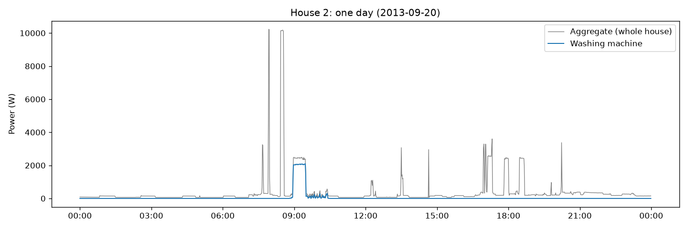
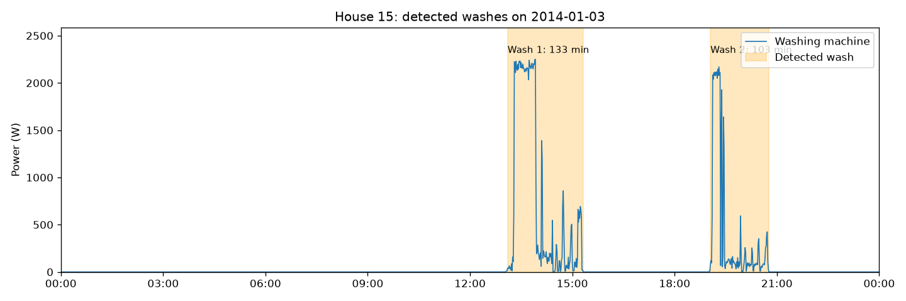
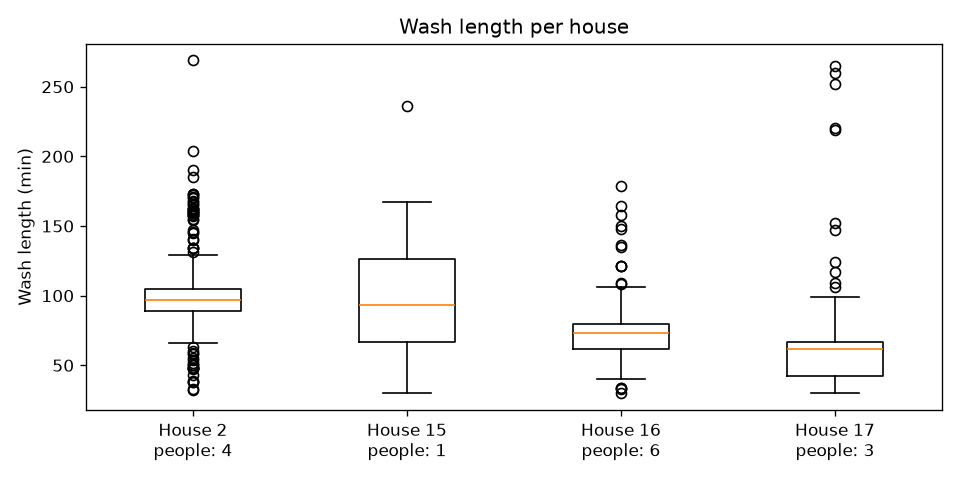
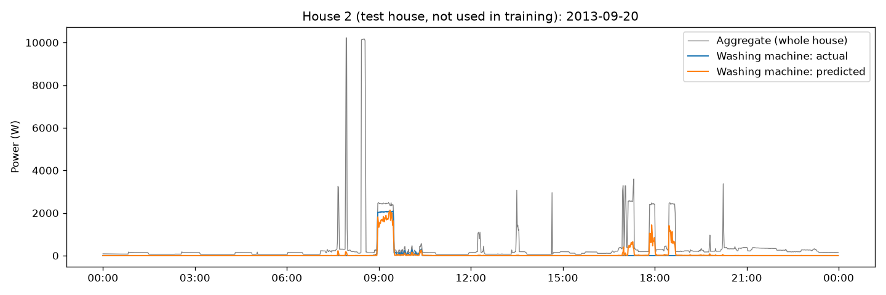

# RESULTS.md: Part 2 (washing-machine analysis) and Part 3 (model)

Part 2 code is in `sourcecode/Section2.py`. Part 3 code is in `sourcecode/Section3.py`.

---

## Part 2: Washing-machine exploratory analysis

### 2.1 Data used

| Item | Value |
|---|---|
| Dataset | REFIT Electrical Load Measurements, **cleaned** version (`CLEAN_REFIT_081116.7z`), University of Strathclyde [1, 2, 3] |
| Files | `CLEAN_House2.csv`, `CLEAN_House15.csv`, `CLEAN_House16.csv`, `CLEAN_House17.csv` |
| Columns used | `Unix`, `Aggregate`, and the washing machine column of each house (renamed to `WM`) |
| Units | Active power in Watts (W) |
| Resolution | Raw readings every ~8 s, averaged to **1 minute**. A minute with no reading at all is left empty (NaN). |
| Time | `Unix` (UTC) converted to **UK local time** (Europe/London), so hour-of-day matches the household clock. UK summer time (+1 h) is already added, and times are stored as plain UK clock time. In late October the clock goes back, so one hour (01:00–01:59) appears twice each year. This does not affect hour-of-day counts or cycles. |

**Houses and periods used (UK time)**

| House | People | WM column | Machine (readme) | Start | End | Minutes |
|---|---|---|---|---|---|---|
| 2 | 4 | Appliance2 | LG F1289TD | 17 Sep 2013 23:08 | 28 May 2015 09:05 | 889,078 |
| 15 | 1 | Appliance3 | Beko WMB91242LB | 17 Dec 2013 17:24 | 8 Jul 2015 03:10 | 817,007 |
| 16 | 6 | Appliance5 | Bosch WAB24262GB/01 | 10 Jan 2014 10:58 | 8 Jul 2015 03:10 | 782,833 |
| 17 | 3 | Appliance4 | Bosch Exxcel 8 Vario Perfect | 6 Mar 2014 16:23 | 19 Jun 2015 15:52 | 676,710 |

"Minutes" = all 1-minute steps from the first to the last reading, including empty minutes.

**Why these 4 houses**
- Each has a plain washing machine channel.
- The cleaned readme lists no machine change for these channels.
- They cover 1 to 6 people, which helps the cross-house comparison.
- 4 houses meet the assignment's minimum and allow Part 3 to train on some houses and test on a different one.
- They have 4 different machines (LG, Beko and two Bosch models), so the analysis is not tied to one machine type.

**Houses not used:** H1, H8, H9, H18 (also have a washer dryer), H4 (two washing machines), H13 (washing machine changed 25 Mar 2015), H12 (no washing machine). House 7 was first included and then dropped (see 2.2).

### 2.2 Availability and data quality

**Highest 1-minute washing-machine power**

| House | Max (W) |
|---|---|
| 2 | 2,251 |
| 15 | 2,360 |
| 16 | 2,185 |
| 17 | 2,305 |

- All 4 houses peak at about 2.2–2.4 kW. This is normal for a washing machine and is most likely the water-heating part of a wash (our reading, not stated by REFIT).
- No impossible values remain (REFIT's cleaned data already removed spikes above 4000 W [3]).

**Missing and zero minutes (washing machine column)**

| House | Missing minutes | Missing % | Zero minutes | Zero % | Above 0 W % |
|---|---|---|---|---|---|
| 2 | 218,914 | 24.6 | 632,568 | 71.1 | 4.2 |
| 15 | 111,626 | 13.7 | 678,153 | 83.0 | 3.3 |
| 16 | 135,663 | 17.3 | 604,018 | 77.2 | 5.5 |
| 17 | 41,627 | 6.2 | 613,489 | 90.7 | 3.2 |

- **Missing** = minutes with no reading at all (for example, internet or hardware outages [2]). It ranges from 6.2% (House 17) to 24.6% (House 2).
- **Zero** = the washing machine shows exactly 0 W. The machine is off most of the time.
- **Above 0 W** = washing cycles plus any small power while idle. It is 3–6% of minutes in all 4 houses.
- **Caution:** REFIT's cleaning set missing gaps longer than 2 minutes to 0 [2, 3]. So some "zero" minutes may really be missing readings, and we can't tell them apart.

**Number of washes detected** (final rule in 2.3)

| House | People | Washes | Weeks with data | Washes per week | Median length (min) | With heating | Without heating |
|---|---|---|---|---|---|---|---|
| 2 | 4 | 335 | 66.5 | 5.0 | 97 | 324 | 11 (3%) |
| 15 | 1 | 241 | 70.0 | 3.4 | 93 | 194 | 47 (20%) |
| 16 | 6 | 333 | 64.2 | 5.2 | 73 | 328 | 5 (2%) |
| 17 | 3 | 285 | 63.0 | 4.5 | 62 | 230 | 55 (19%) |

- **Weeks with data** = minutes that are not missing, divided by one week (10,080 minutes). This way, outages don't make a house look like it washes less.
- **Median length** is 62–97 minutes, which fits a normal wash of about 1–2 hours. House 17 has the shortest washes.
- **House 15 (1 person)** washes the least, about 3–4 times a week. Houses 2 and 16 (4 and 6 people) wash about 5 times a week.
- **Washes without heating:** only 2–3% in Houses 2 and 16, but about 20% in Houses 15 and 17. These could be cold or quick washes, or small bursts of activity joined together. We did not check which.

**Dropped: House 7**

House 7 (4 people, washing machine = Appliance5, 1 Nov 2013 → 8 Jul 2015) was first included and then left out. These numbers were found with the first version of the rule (see 2.3):

| | House 7 | Other 4 houses (same rule) |
|---|---|---|
| Minutes above 0 W | 22.0% | 3–6% |
| Washes per week | 11.9 | 2.8–5.1 |
| Median wash length | 60 min | 51–95 min |

- Its washing machine channel shows power far more often than the other houses, and the rule found more than double the number of washes.
- Possible reasons: something else plugged in on the same monitor, or real washes cut into pieces by longer pauses. **We did not check which one.** Because the channel may not show only the washing machine, we left this house out to keep the analysis clean.

### 2.3 Rule for an active cycle (one wash)

**The rule (in plain words)**
1. The machine is **ON** when it uses **more than 20 W**. 20 W or less (off, standby, filling water) and missing minutes count as not ON.
2. **Heating** = the machine uses **1,500 W or more for at least 5 minutes in a row**.
3. A break **under 30 minutes** does not end a wash (for example, a pause while new water fills in).
4. A break of **30 minutes or more** means the wash is over. The next ON minute starts a new wash. The wash ends at its last ON minute; the 30 quiet minutes are not counted in its length.
5. **One heating = one wash.** A wash heats its water once, so if a second heating appears, a new wash starts there, even after a short break. This splits two washes done one right after the other.
6. A wash must last **at least 30 minutes** (from its first to its last ON minute). Anything shorter is a blip.

In the code, breaks of only 1–2 minutes are joined first into small "pieces" (Step A), and the pieces are then joined into washes using rules 3–5 (Step B).

**How we got to this rule**
1. **First try: a rule from a paper.** The REFIT papers do not give a cycle rule (the 2017 paper counts appliance uses with "edge detection" but gives no threshold or time values [2]). So we first used the washing-machine settings of Kelly & Knottenbelt [4], a widely used NILM paper based on UK-DALE (another UK dataset): ON above 20 W, a wash ends after being off for 160 s (3 minutes with 1-minute data), and a wash lasts at least 1,800 s (30 minutes).
2. **The plot showed a problem.** On House 15, 3 Jan 2014 (Plot 2), the 3-minute rule cut the afternoon wash at 80 minutes (its rinse and spin were lost) and split the evening wash into two (55 + 45 minutes). In this machine, the pauses while draining, refilling and between rinses last about 5–10 minutes.
3. **Why one short break can't fit all machines.** How long these pauses last depends on the machine, how full the drum is, the water pressure (fill time) and the drain setup. Our 4 houses have 4 different machines.
4. **New idea: one heating = one wash.** Each wash heats its water once, near the start. So a heating can mark a new wash. This lets us use a long break limit (30 minutes) without joining two washes done one after the other.

**Where each number comes from**

| Setting | Value | Source |
|---|---|---|
| ON level | 20 W | Kelly & Knottenbelt [4] |
| Small breaks joined first | 1–2 min | Kelly & Knottenbelt [4] (160 s) |
| Minimum wash length | 30 min | Kelly & Knottenbelt [4] (1,800 s) |
| Break that ends a wash | 30 min | Our choice. Pauses inside a wash were about 5–10 min in the plot, so 30 min leaves room |
| Heating | ≥ 1,500 W for ≥ 5 min | Our choice. In the plots, heating sits at about 2,000–2,250 W for 20–35 min, while other spikes (1,400–1,900 W) last only 1–2 min |

**Why 20 W:** an idle machine uses only a few watts, and 20 W ignores that. But it is still low enough to keep the quiet parts of a wash, such as the drum turning, or a cold wash with no heating.

**First rule vs final rule**

| House | Washes (first rule) | Washes (final rule) | Median length (first) | Median length (final) |
|---|---|---|---|---|
| 2 | 340 | 335 | 95 min | 97 min |
| 15 | 198 | 241 | 83.5 min | 93 min |
| 16 | 328 | 333 | 72 min | 73 min |
| 17 | 251 | 285 | 51 min | 62 min |

- Houses 2 and 16 hardly changed, so their machines have short pauses and the first rule already worked there.
- Houses 15 and 17 changed the most. Their washes have longer pauses. With the first rule, some washes were cut into pieces that were each under 30 minutes, so they were not counted at all. Now those pieces are joined into one wash, so the count goes up and washes get longer.

**Known limits of the rule**
- **Cold washes** have no heating. They are still counted if they last 30+ minutes, but if one starts less than 30 minutes after another wash ends, it is joined to that wash.
- **A programme that heats twice** (for example, with a pre-wash) is counted as two washes.
- **Very short programmes** (under 30 minutes) are not counted.
- **The 30-minute break and the heating level are our own choices**, based on plots, not taken from a paper.
- **Washes without heating** are about 20% in Houses 15 and 17. Some of these may not be real washes (see 2.2).

### 2.4 Usage by hour of day and day of week

**Method**
- Each wash is counted **once, at its start time** (UK clock time). A wash from 13:05 to 15:18 counts once, in hour 13.
- Results are shown as **% of each house's washes**, because the houses have different numbers of washes (241 to 335).
- If washes were spread evenly, each hour would have 4.2% (100 / 24), each day 14.3% (100 / 7), and the weekend (Sat + Sun) 28.6% (2 / 7).

**Busiest hour, busiest day and weekend share**

| House | People | Busiest start hour | Busiest day | Weekend (Sat + Sun) |
|---|---|---|---|---|
| 2 | 4 | 09:00–09:59 (12.2%) | Mon (17.3%) | 24.8% |
| 15 | 1 | 11:00–11:59 (9.1%) | Thu (19.5%) | 28.2% |
| 16 | 6 | 18:00–18:59 (12.6%) | Fri (22.8%) | 31.8% |
| 17 | 3 | 09:00–09:59 (13.0%) | Sat (23.5%) | 28.1% |

- **Hour:** in 3 houses the busiest start hour is in the **morning** (9–11 am). In House 16 (6 people) it is in the **early evening** (6 pm). The busiest hour has about 2–3 times the even share (9–13% vs 4.2%). Only the single busiest hour was checked, so this does not show how the other washes are spread over the day.
- **Day:** each house has its own "wash day", and it is a **different day in every house** (Mon, Thu, Fri, Sat).
- **Weekend:** the weekend share is **close to even (25–32%)**, so these houses do not wash much more at weekends overall. House 17 is a mix: Saturday is its busiest day (23.5%), which leaves only about 4.6% for Sunday.
- **Limit:** outages are not spread exactly evenly over hours and days, so missing data may tilt these numbers a little. With 63–70 weeks of data per house, the effect should be small. We did not correct for it.

### 2.5 Cycle comparison across houses: wash length

**Feature:** wash length = minutes from the first to the last ON minute of a wash (rule in 2.3). We picked it because it comes straight from the detected washes, with no extra assumptions.

| House | People | Washes | Median length (min) | Middle half (min) | Washes per week |
|---|---|---|---|---|---|
| 2 | 4 | 335 | 97 | 89–105 | 5.0 |
| 15 | 1 | 241 | 93 | 67–126 | 3.4 |
| 16 | 6 | 333 | 73 | 62–80 | 5.2 |
| 17 | 3 | 285 | 62 | 42–67 | 4.5 |

"Middle half" = the middle 50% of washes (from the 25th to the 75th percentile).

- **A typical wash differs by about 35 minutes between houses** (median 62 to 97 min).
- **More people means more washes, but not longer washes.** House 16 (6 people) washes more often than House 15 (1 person), but its washes are shorter. Wash length seems to depend more on the machine and the programmes chosen. With only 4 houses, this is an observation, not a firm rule.
- **Some houses almost always use the same programme.** Houses 2 and 16 have a narrow middle half (16–18 min wide). House 15 has a wide one (59 min), so it mixes short and long programmes.
- See Plot 3 in 2.6.

### 2.6 Plots

#### Plot 1: one day, Aggregate + washing machine (House 2, 20 Sep 2013)

The day was picked automatically: the first House 2 day with exactly one detected wash and no missing minutes (the same day is picked with the first and the final rule).

- **The wash (about 08:55–10:25):** the washing machine first heats water at about 2,050 W for roughly 30 minutes. Then it drops to a low, uneven 100–500 W while the drum turns, rinses and spins.
- **The same wash shows in the Aggregate:** the grey line rises by about 2 kW during heating, on top of the house's normal base load of a few hundred watts.
- **Other appliances make big jumps too:** short spikes of about 3 kW (probably the kettle) and two very large ones of about 10 kW around 08:00 and 08:30 (perhaps an electric shower; not in the readme, our guess). In the evening (17:00–19:00) there are blocks of about 2.4–2.6 kW that look a lot like the washing machine's heating, but the washing machine is off.
- **What this means for Part 3:** the heating part of a wash is easy to see in the Aggregate. But other appliances with a similar power can be mistaken for it, and the low-power part of a wash is almost hidden among other loads.

#### Plot 2: detected washes on one day (House 15, 3 Jan 2014)

The day was picked automatically: the first House 15 day with 2 or more detected washes and no missing minutes. The orange areas are the washes found by the rule.

- **Two washes:** about 13:05–15:18 (133 min) and 19:05–20:48 (103 min).
- **Each wash has the same shape:** first about 30 minutes of heating at 2.1–2.2 kW, then low power with bursts of 100–900 W while the drum washes, rinses and spins, separated by pauses of several minutes.
- **The rule covers each whole wash,** including the rinse and spin bursts at the end, and does not split a wash at its pauses.
- **This plot is why we changed the rule:** with the first rule (3-minute break), the afternoon wash was cut at 80 minutes and the evening wash was split into 55 + 45 minutes (see 2.3).

#### Plot 3: cross-house comparison, wash length per house

**How to read it:** the orange line is the median wash, the box holds the middle half of the washes, the lines reach up to 1.5 times the box height beyond the box (matplotlib's default), and the dots are unusual washes beyond that.

- **Medians:** House 2 = 97 min, House 15 = 93, House 16 = 73, House 17 = 62.
- **House 15 (1 person) has the widest box (67–126 min).** Its washes vary the most, so it likely uses several different programmes (our reading).
- **House 2 has many dots on both sides** because its box is very narrow: the lines are short, so even fairly normal short or long washes show as dots.
- **Very long washes (above ~150 min, up to ~270 min in Houses 2 and 17)** could be long programmes, or two washes joined by our rule (a cold wash starting less than 30 minutes after another one, see 2.3). We did not check which.
- **What this means for Part 3:** a wash looks different in each house, so a model trained on some houses may not fit the machine in a new house as well. Testing on a house the model has not seen will show this.

---

## Part 3: Disaggregation model

### 3.1 Task and data

| Item | Value |
|---|---|
| Goal | Guess the washing-machine power (`WM`, in W) for each minute, using only the whole-house power (`Aggregate`) |
| Dataset | REFIT cleaned data, the same 4 houses and periods as Part 2 (see 2.1) [1, 2, 3] |
| Resolution | 1 minute |
| Minutes used | Only minutes where both `Aggregate` and `WM` have data (for training and for scoring) |

| House | All minutes | Minutes with Aggregate + WM | % |
|---|---|---|---|
| 2 | 889,078 | 670,164 | 75.4 |
| 15 | 817,007 | 705,381 | 86.3 |
| 16 | 782,833 | 647,170 | 82.7 |
| 17 | 676,710 | 635,083 | 93.8 |

- The usable minutes are exactly the minutes where the washing machine has data (all minutes minus the missing WM minutes in 2.2). So whenever the washing machine has a reading, the Aggregate has one too.

### 3.2 Validation design: leave one house out

| Round | Train on | Test on | Training minutes |
|---|---|---|---|
| 1 | Houses 15, 16, 17 | House 2 | 1,987,634 |
| 2 | Houses 2, 16, 17 | House 15 | 1,952,417 |
| 3 | Houses 2, 15, 17 | House 16 | 2,010,628 |
| 4 | Houses 2, 15, 16 | House 17 | 2,022,715 |

- Each round trains a **new model from scratch** on 3 houses and tests it on the 4th. Every house is the test house once, and the result for each house is reported.
- **Why split by house:** this is the real use case. A utility wants to estimate washing-machine use in homes that have no plug meter. The assignment prefers a split by house or by time, and Kelly & Knottenbelt [4] also test on a house that was not used in training. A split by house is also the harder test, because each house has a different machine (2.5).
- **Why not random minutes:** neighbouring minutes are almost the same. With a random split, the minutes just before and after a test minute would be in training, so the model would "see the answer" and the score would look better than it really is.
- **How leakage is avoided:**
  - No minute, wash or machine of the test house is used in training.
  - The usage-profile baseline (3.3) is also built from the 3 training houses only.
  - Inputs are made separately for each house, so a time window never mixes two houses.
  - All rounds use the same model settings.
- **Honest note:** model v2 (3.4) was added after we saw the v1 results. It was the only change, it uses numbers from Part 2, and both versions are reported. No setting was tuned to the test scores.

### 3.3 Baselines

1. **Always-off:** guess 0 W for every minute. The machine is off most of the time, so this shows whether a low error on its own means anything.
2. **Usage profile:** for each hour of the day (0–23), guess the average washing-machine power at that hour, worked out from the 3 training houses only. It uses only the clock, not the Aggregate. We used the hour of day only, not the day of week, because each house has a different wash day (2.4).

### 3.4 Model

- **Gradient boosting** (`HistGradientBoostingRegressor` from scikit-learn), one of the examples listed in the assignment.
- **Settings:** scikit-learn's defaults, except `early_stopping=False` (so no random training minutes are held back) and `random_state=0` (the same result on every run). Guesses below 0 W are set to 0 W (our choice).
- **Why this model:** it is fast (a few seconds per round on about 2 million minutes, on a laptop), it handles missing values (NaN) by itself, and it is easy to explain. A neural network such as Seq2Point [5] is often more accurate in papers, but it is slower and harder to justify for this task.

**Inputs (all made from the Aggregate only)**

| # | Input | Meaning | v1 | v2 |
|---|---|---|---|---|
| 1 | `agg` | Aggregate this minute | ✓ | ✓ |
| 2 | `diff` | change from the minute before (a big jump = something switched on or off) | ✓ | ✓ |
| 3 | `mean_30` | average Aggregate over the 31 minutes around this minute (15 before, 15 after) | ✓ | ✓ |
| 4 | `max_30`, `min_30` | highest and lowest Aggregate in those 31 minutes | ✓ | ✓ |
| 5 | `std_30` | how much the Aggregate jumps around in those minutes (the drum and spin make it bumpy) | ✓ | ✓ |
| 6 | `above_base` | Aggregate minus the lowest value in the 2 hours around (removes the always-on load, such as the fridge) | ✓ | ✓ |
| 7 | `hour` | hour of day (0–23) | ✓ | ✓ |
| 8 | `heat_now` | 1 if the Aggregate is 1,500–3,000 W above the base for 5+ minutes in a row | | ✓ |
| 9 | `since_heat` | minutes since the last heating minute (0 = heating now) | | ✓ |

- **Why windows:** one minute is not enough. A kettle and washing-machine heating can both show 2,400 W, but a kettle lasts 2–3 minutes and heating 20–35 minutes, so their 30-minute averages are very different. The window sizes are our choice, based on Part 2. Seq2Point [5] uses the same idea of a window around each minute.
- **Future minutes:** the windows also look 15–60 minutes ahead. This is fine for analysing past data (for example, yesterday's), but the model cannot run live, minute by minute.
- **v2 adds the "one heat = one wash" idea from Part 2.** Heating marks a wash, and the low, bumpy power after it is the same wash still running (rinse and spin). `heat_now` uses the same numbers as the Part 2 heating rule (1,500 W for 5 minutes). The 3,000 W upper limit is our choice: the washing machine's highest 1-minute power was 2.2–2.4 kW (see section 2.2), and the limit ignores the ~10 kW shower. `since_heat` lets the model learn from the training houses how long a wash goes on after heating, instead of us fixing one length, because wash length differs a lot between houses (2.5).

### 3.5 Metrics

| Metric | What it is | Why it is useful |
|---|---|---|
| MAE (W) | Average of \|actual − guess\| over all minutes | Easy to read in watts. But always-off already scores low, because the machine is off most of the time |
| Energy error (%) | (total guessed energy − total actual energy) / total actual energy | Answers the utility question "how much did the washing machine use?". But too-high and too-low minutes cancel out |
| F1 (0 to 1) | Each minute is ON if above 20 W (same as Part 2). Precision = share of guessed-ON minutes that are really ON. Recall = share of real ON minutes that were found. F1 combines both | Checks the timing of washes. Always-off gets 0 |

- Each metric catches what the others miss, so all three are reported. Kelly & Knottenbelt [4] also use MAE, F1 and a total-energy error.

### 3.6 Results

Each house is scored as the test house, with a model trained on the other 3 houses. Best value per house in **bold** (for energy error: closest to 0%).

| House | Method | MAE (W) | Energy error | F1 | Precision | Recall |
|---|---|---|---|---|---|---|
| 2 | Always-off | **18.1** | −100% | 0.00 | 0.00 | 0.00 |
| 2 | Usage profile | 31.7 | **−13%** | 0.14 | 0.08 | 0.80 |
| 2 | Model v1 | 37.4 | +87% | 0.26 | 0.18 | 0.44 |
| 2 | Model v2 | 37.8 | +98% | **0.34** | 0.24 | 0.56 |
| 15 | Always-off | 17.2 | −100% | 0.00 | 0.00 | 0.00 |
| 15 | Usage profile | 32.0 | **−7%** | 0.07 | 0.04 | 0.59 |
| 15 | Model v1 | 14.0 | −62% | 0.56 | 0.63 | 0.50 |
| 15 | Model v2 | **13.1** | −62% | **0.75** | 0.79 | 0.71 |
| 16 | Always-off | **19.3** | −100% | 0.00 | 0.00 | 0.00 |
| 16 | Usage profile | 33.2 | **−21%** | 0.08 | 0.05 | 0.51 |
| 16 | Model v1 | 33.6 | +36% | 0.23 | 0.14 | 0.61 |
| 16 | Model v2 | 31.5 | +31% | **0.32** | 0.20 | 0.78 |
| 17 | Always-off | **10.5** | −100% | 0.00 | 0.00 | 0.00 |
| 17 | Usage profile | 27.3 | +74% | 0.08 | 0.04 | 0.85 |
| 17 | Model v1 | 17.4 | +20% | 0.31 | 0.19 | 0.77 |
| 17 | Model v2 | 15.5 | **+10%** | **0.37** | 0.25 | 0.74 |

**What the results show**
1. **Finding washes (F1):** model v2 is the best in all 4 houses (0.32–0.75, against 0.14 or less for the usage profile). So the model really uses the Aggregate.
2. **The heating idea helps:** v2 has a higher F1 than v1 in all 4 houses (+0.06 to +0.19). It finds more of the real wash minutes (recall goes up in 3 houses), mostly the rinse and spin part after heating.
3. **Power error (MAE):** v2 beats always-off only in House 15. In Houses 2, 16 and 17 the model has many false alarms (precision 0.20–0.25), so its MAE is worse than doing nothing.
4. **Energy:** the model's total is too high in Houses 2, 16 and 17 (+10% to +98%) and too low in House 15 (−62%). The usage profile is closer in 3 houses, but it cannot tell when a wash happens (F1 of 0.14 or less).
5. **House 15 (1 person) is the easiest** (F1 0.75, precision 0.79). Our guess: fewer other big appliances run at the same time.

**In short:** in a house it has never seen, the model can roughly tell **when** the washing machine runs, but its power and energy numbers are **not reliable yet**. The main reason is that other ~2 kW heating appliances look like washing-machine heating.

### 3.7 Plot: actual vs predicted (evaluation data)

House 2 is the test house here (round 1: the model was trained on Houses 15, 16 and 17 only). Model v2, 20 Sep 2013: the same day as Part 2 Plot 1, which was picked automatically there.

- **The wash (about 09:00–10:25):** the guess (orange) follows the real washing machine (blue), including the small rinse and spin bursts after the heating.
- **The ~10 kW shower (about 08:00 and 08:30) and the short ~3 kW kettle spikes:** the guess stays at or near 0 W. They are too high or too short to look like heating.
- **The evening blocks (about 17:50–18:05 and 18:30–18:45):** the Aggregate shows two ~2.4 kW blocks while the washing machine is off, and the model guesses 1,000–1,400 W. These are false alarms (see 3.8).
- **During the real heating,** the guess is about 1,700 W instead of about 2,050 W.

### 3.8 Failure cases

1. **Other heating appliances look like the washing machine.** Any appliance that heats at about 2 kW for 10+ minutes looks like washing-machine heating in the Aggregate. In the plot, the two evening blocks cause false alarms of 1,000–1,400 W. Two blocks about 30 minutes apart would fit a dishwasher heating its water twice, and House 2 has a dishwasher (readme). This is our guess; we did not check the dishwasher channel. The other houses have similar appliances: a tumble dryer in Houses 15 and 17, and two electric heaters in House 16 (readme). This is the main reason for the low precision and too-high energy in Houses 2, 16 and 17.
2. **When unsure, the model guesses in between.** The model is trained to keep the squared error small (scikit-learn's default). So when a block could be the washing machine or not, it guesses a middle value: too low on the real wash (about 1,700 instead of 2,050 W) and too high on the false alarm. This may also be why House 15 finds most wash minutes (precision 0.79, recall 0.71) but its energy is still 62% too low (our reading, not checked).
3. **Likely to struggle (not tested):**
   - **Cold washes** with no heating (about 20% of washes in Houses 15 and 17, see 2.2), because v2's heating inputs give no clue for them.
   - **Two appliances at once.** For example, a kettle during the heating can push the Aggregate above the 3,000 W limit and cut the heating block short.

### 3.9 Limits

- Only 4 houses, so each model learns from just 3 washing machines.
- v2 was chosen after seeing v1's test results (one change only; both are reported).
- The model settings were not tuned (scikit-learn defaults).
- The windows use future minutes, so the model works on past data, not live.
- REFIT's cleaning set long gaps to 0 [2, 3], so some "0 W" minutes in the target may really be missing (see 2.2).

---

## References

1. Murray, D., Liao, J., Stankovic, L., Stankovic, V., Hauxwell-Baldwin, R., Wilson, C., Coleman, M., Kane, T. & Firth, S. (2015). *A data management platform for personalised real-time energy feedback.* Proceedings of the 8th International Conference on Energy Efficiency in Domestic Appliances and Lighting (EEDAL). http://strathprints.strath.ac.uk/54966/
2. Murray, D., Stankovic, L. & Stankovic, V. (2017). *An electrical load measurements dataset of United Kingdom households from a two-year longitudinal study.* Scientific Data 4, 160122. https://doi.org/10.1038/sdata.2016.122
3. REFIT: Electrical Load Measurements (Cleaned), dataset page and readme, University of Strathclyde. https://pureportal.strath.ac.uk/en/datasets/refit-electrical-load-measurements-cleaned/
4. Kelly, J. & Knottenbelt, W. (2015). *Neural NILM: Deep neural networks applied to energy disaggregation.* Proceedings of the 2nd ACM International Conference on Embedded Systems for Energy-Efficient Built Environments (BuildSys '15). https://arxiv.org/abs/1507.06594 (washing-machine settings in Table 4; tests on a house not used in training)
5. Zhang, C., Zhong, M., Wang, Z., Goddard, N. & Sutton, C. (2018). *Sequence-to-point learning with neural networks for non-intrusive load monitoring.* Proceedings of the 32nd AAAI Conference on Artificial Intelligence (AAAI-18). https://arxiv.org/abs/1612.09106
